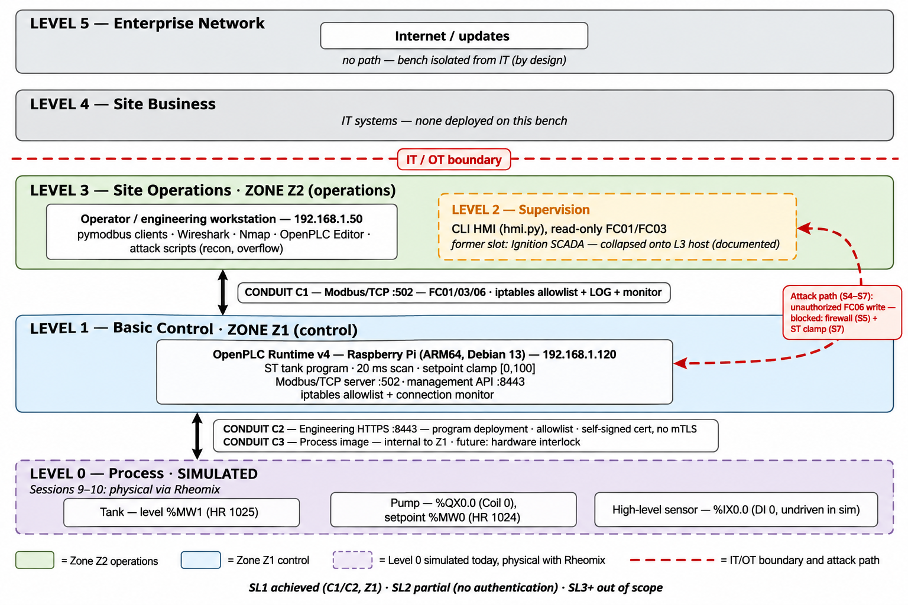

# Session 8: IEC 62443 applied to the bench, zones, conduits and a Purdue diagram

> File: `docs/session-08.md` at the root of the `ot-lab` repository.

## Objective

Formalize the bench's security architecture the way the industry does it: map the lab onto the Purdue reference model, define IEC 62443 zones and conduits, and produce a reusable 62443-4-1 mini-checklist. Everything below is derived from the *actual* bench built in Sessions 1–7. This is not a textbook diagram; it is the lab's own architecture, annotated.

Note: the Ignition SCADA (Session 6) ran on a trial license and is no longer active. The supervision layer is currently the CLI HMI (`scripts/hmi.py`). The architecture below documents both the as-built state and the SCADA slot it occupied; the zone structure does not change.

## 1. The bench on the Purdue model

*Diagram evidence: [`captures/session8-purdue.png`](../captures/session8-purdue.png).*

Reading of the diagram:

- **Levels 5 and 4 are empty by design.** The bench has no enterprise network and no IT systems; it is isolated, which is itself a 62443 posture (no unnecessary connectivity).
- **Levels 3 and 2 collapse onto one machine.** The operator workstation hosts both engineering tools (Editor, scripts, Wireshark) and the supervision HMI. In a real plant these are separated; on a one-person bench, documenting the collapse honestly is better than drawing a fiction.
- **Level 0 is simulated.** The tank/pump exist as PLC memory. (The Rheomix physical integration was initially planned for Sessions 9–10 and was dropped as a separate decision; Level 0 stays simulated.)

## 2. Zones and conduits (62443-3-2 reading)

| Zone | Assets | Criticality / rationale | Current safeguards |
|---|---|---|---|
| **Z1 - Control zone** | Raspberry Pi: OpenPLC runtime, ST program, Modbus server | Highest; it commands the (future) physical process | ST setpoint clamp (S7); hardened runtime; no inbound IT connectivity |
| **Z2 - Operations zone** | PC: HMI, pymodbus clients, Wireshark, OpenPLC Editor | Medium; trusted host, but proven writable-by-malware (S5: nine FC06 from this host) | Host firewall hygiene assumed; no malware controls (documented gap) |
| **C1 - Modbus conduit** | TCP/502 traffic PC ↔ Pi | Carries control writes; the attack path of Sessions 4–7 | iptables allowlist (S5) + connection monitor (S5) + kernel LOG |
| **C2 - Engineering conduit** | TCP/8443 traffic PC ↔ Pi | Carries program deployment; worst-case path (program replacement) | iptables allowlist (S5); HTTPS with self-signed cert (no mTLS) |
| **C3 - Process conduit** | PLC internal: process image ↔ simulated I/O | Internal to Z1 | ST logic; (future: hardware interlock with Rheomix) |

The 62443 insight the bench demonstrates best: **a conduit is secured, not trusted.** C1 is allowlisted, yet Sessions 4–7 showed that a compromised Z2 host attacks through it anyway, hence the S7 application-layer defense inside Z1. Zones contain; conduits filter; neither replaces validation at the point of use.

## 3. Security levels: where the bench stands

IEC 62443 defines SL 1–4 per zone/conduit. Honest self-assessment:

| Target | Status |
|---|---|
| SL 1 (protection against casual misuse) | **Achieved** on C1/C2 (allowlist) and Z1 (input validation) |
| SL 2 (intentional violation by low capability) | **Partial**; no authentication anywhere; a motivated attacker on the LAN with the PC's IP (spoofing) bypasses the allowlist; ARP spoofing untested |
| SL 3+ (sophisticated actor) | **Not targeted**; out of scope for a home bench, the gap is documented, not hidden |

The SL framing is the interview answer: *not* "is it secure?" but "what security level does each zone/conduit achieve, and what is the residual risk?"

## 4. IEC 62443-4-1 mini-checklist (Reusable artifact)

62443-4-1 defines the *secure development lifecycle* a product maker must run. Condensed to the questions a machine-builder's BE can act on; this is the "mini-outil open source" format of the public-proof plan:

| # | 62443-4-1 practice | Question for a machine builder | Evidence to ask for |
|---|---|---|---|
| 1 | Security requirements (SR) | Are security requirements derived from a threat model, or copied from a datasheet? | Threat model doc; SR traceability |
| 2 | Secure architecture | Are zones/conduits designed into the product, or is security a firewall sold alongside? | Architecture doc with zones; SL targets |
| 3 | Input validation | Does the PLC/controller reject out-of-range or malformed commands? (Bench proof: S7 clamp) | Range-check code; fuzz/abuse test results |
| 4 | Authentication | Can any network client write control values? (Bench: yes; documented gap) | Auth design (per-user, per-role); no shared passwords |
| 5 | Access control / RBAC | Are engineering vs operator rights separated? | Role matrix; default-deny evidence |
| 6 | Update mechanism | Is there a signed, authenticated firmware/software update path? | Update spec; signing keys handling |
| 7 | Vulnerability handling | Is there a PSIRT/contact and a disclosure policy? | Policy URL; SBOM availability |
| 8 | Cryptography | Are crypto choices documented and updatable (post-quantum inventory)? | Crypto inventory |
| 9 | Logging / detection | Does the product log security events (failed logins, unexpected writes)? | Log spec; bench analog: S5 kernel LOG + monitor |
| 10 | Lifecycle | Are patches promised for the machine's 10–20 year life? | Support policy per product line |

Usage: this table is the CRA-adjacent conversation starter with a fabricant type Pinette PEI. Ten questions that map a supplier's maturity without reading the standard.

## 5. What this session does and does not prove

- The Purdue mapping and zone/conduit split are **documentation of the real bench**, each box traceable to a session's evidence, not an idealized design.
- The SL self-assessment is the author's, on a simulator; it is a learning artifact, not an assessment of any commercial product.
- The 62443-4-1 checklist is a study summary for engineering conversations, not the standard itself (the full text is copyrighted; the practices above are paraphrased).

## Session deliverables

- [x] Purdue diagram of the bench, annotated with real IPs, ports, and session references
- [x] Zones and conduits table with current safeguards and known gaps
- [x] Security Level self-assessment (SL 1 achieved, SL 2 partial, gaps named)
- [x] 62443-4-1 mini-checklist (10 practices, reusable format)
- [x] Commit: `docs(session-08): IEC 62443 zones/conduits, Purdue diagram and 4-1 mini-checklist`

## Next step

The Rheomix physical integration (ADS1115 + clamp sensor acquisition, relay command with hardware interlock and emergency stop) was initially planned as Sessions 9–10 and was dropped as a separate decision; the safety rule it carried (interlock hardware + emergency stop, never write to an actuator over the network) stays recorded in the README.