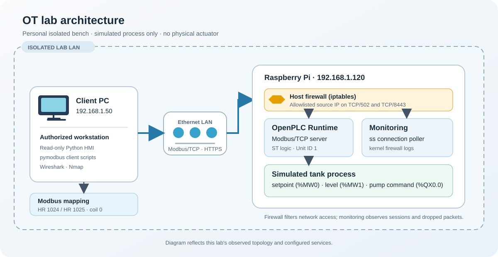
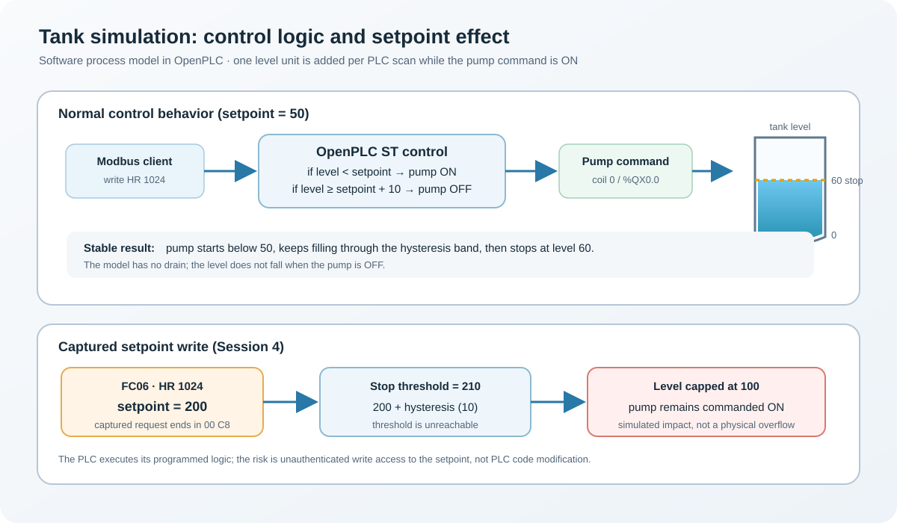

# Write-up #1 - Attacking and defending a personal OpenPLC OT bench

## TL;DR

I built a small OT lab on a Raspberry Pi: OpenPLC v4 runtime running a Structured Text tank-filling program, exposed over Modbus/TCP. From my PC, I then played the attacker: enumerated the process over Modbus, and pushed an out-of-range setpoint with a single 12-byte request. The simulated pump ran forever because the stop threshold became unreachable. Finally I added network filtering and connection monitoring, replayed the attack path, and verified the defense. Classic Modbus/TCP has no authentication by design: perimeter filtering decides who can reach the PLC, and the PLC itself will faithfully execute whatever the accepted client writes.

Scope: personal, isolated lab, simulated process. No third-party system, no physical pump was controlled. All claims below link to evidence committed in this repository.

## 1. The bench



The client reaches the Pi over the isolated LAN: Modbus/TCP uses port 502 and the OpenPLC management interface uses HTTPS on port 8443. The host firewall filters those services; connection polling and kernel logs run on the Pi. The tank is a software simulation, not a physical process.

| Component | Detail |
|---|---|
| PLC | OpenPLC Runtime v4, native install, Raspberry Pi (ARM64, Debian 13) at `192.168.1.120` |
| PLC program | Structured Text tank control, 20 ms scan (`scripts/main.st`) |
| Process (simulated) | Pump fills a tank; hysteresis of 10 between pump-on (level < setpoint) and pump-off (level ≥ setpoint + 10); level capped at 100 |
| Protocol | Modbus/TCP on port 502 (plugin `modbus_slave`, segmented address map) |
| Management | OpenPLC runtime HTTPS API on port 8443, driven from OpenPLC Editor v4 on the PC |
| Client PC | `192.168.1.50`, Python clients with `pymodbus`, Wireshark, Nmap |
| HMI | Read-only CLI dashboard polling FC03/FC01 every 200 ms (`scripts/hmi.py`) |

Variable-to-Modbus mapping, which became the asset inventory for the attack:

| Modbus point | PLC variable | Meaning |
|---|---|---|
| Holding register 1024 | `setpoint` (`%MW0`) | Requested tank level |
| Holding register 1025 | `level` (`%MW1`) | Simulated tank level |
| Coil 0 | `pump_output` (`%QX0.0`) | Pump command |

Session logs: [session-01](../docs/session-01.md) (install), [session-02](../docs/session-02.md) (first program + Modbus map), [session-03](../docs/session-03.md) (autonomous tank, packet analysis, HMI).

## 2. Reconnaissance

From the client PC, before any credential or documentation assumptions:

- **Nmap service discovery** ([captures/session4-nmap.txt](../captures/session4-nmap.txt)): host up, `502/tcp open — Modbus TCP`, `8443/tcp open - HTTPS (Werkzeug/Python)`, device identified as a Raspberry Pi. Two high-value services, one of them an unauthenticated industrial protocol.
- **Register enumeration** (`scripts/attack_recon.py`, raw output in [captures/session4-recon.txt](../captures/session4-recon.txt)): reading holding registers and coils reveals the process state in seconds. One register changes by itself (level), one stays constant (setpoint), one coil flips periodically (pump). Modbus gives the process away for free: no login, no error, no trace.

A point-in-time register snapshot was enough to fingerprint the process. Full reasoning in [session-04](../docs/session-04.md).

## 3. Attack - One 12-Byte request, a pump that never stops

`scripts/attack_overflow.py` writes `200` to holding register 1024 (the setpoint). The captured request ([captures/session4-attack.pcapng](../captures/session4-attack.pcapng)):

```text
00 01 00 00 00 06 01 06 04 00 00 C8
```

| Bytes | Meaning |
|---|---|
| `00 01` | Transaction ID |
| `00 00` | Protocol ID 0 (Modbus) |
| `00 06` | MBAP length |
| `01` | Unit ID 1 |
| `06` | Function 06 - Write single register |
| `04 00` | Register address 1024 (setpoint) |
| `00 C8` | Value 200 |

The server echoed the write ~5 ms later. Captured process timeline:

| Time (relative to write) | Setpoint | Level | Pump |
|---|---:|---:|---|
| −0.17 s | 50 | 60 | OFF |
| +0.17 s | 200 | 67 | ON |
| +0.85 s | 200 | 100 | ON |
| rest of capture | 200 | 100 (capped) | **ON, indefinitely** |

Why it fails forever: the stop condition is `level ≥ setpoint + 10` = 210, but the program clamps `level` at 100. The threshold is unreachable, so `pump_output` stays TRUE. The important point is that the PLC was never "hacked": its logic kept running correctly and obeyed an absurd but formally valid setpoint. The actual vulnerability is that anyone on the network can be a valid Modbus client.



What this does *not* prove, and why that matters: the PLC program was not modified, no physical equipment was involved, and the write only succeeded because this client was not filtered. Getting that precision right is what separates a lab report from a claim.

## 4. Defense - Filter, monitor, prove

Three layers, all on the bench:

1. **Network filtering** (iptables on the Pi): TCP/502 and TCP/8443 accepted from the authorized PC only, everything else logged (`MODBUS-DROP` prefix) then dropped. Rules persisted across reboot and re-verified ([captures/session5-rules.txt](../captures/session5-rules.txt)).
2. **Connection monitoring** (`scripts/detect_modbus.py`): polls `ss` every second on the PLC for established connections to port 502, compares against an allowlist, alerts on unexpected clients and on disconnects. This is session-level detection; the firewall log covers the per-packet side (dropped SYNs from short-lived one-shots).
3. **Replay with evidence**: the deny path was exercised with a temporary rule blocking the authorized PC. Result: SYN packets logged and dropped ([captures/session5-defense.pcapng](../captures/session5-defense.pcapng)), kernel `MODBUS-TEST-DROP` entries, no Modbus exchange from the blocked client.

Before/after:

| | No defense (Session 4) | Filtered + monitored (Session 5) |
|---|---|---|
| Unauthorized read | Instant, no trace | TCP SYN logged and dropped before session establishment |
| Illicit setpoint write | Accepted in ~5 ms | Blocked path: no FC06 reaches the server |
| Detection | None | Kernel log prefix + session-level alert on unexpected clients |

One limitation, kept visible in the evidence: the filter is IP-based. The capture itself contains nine successful FC06 writes of 200 during the "defended" window, all from the authorized PC. Any malicious code running on a trusted machine writes freely. The perimeter is necessary but not sufficient, and device-level trust would require what entry-level PLCs do not offer. Write-up #2 picks up from exactly this point.

Full details: [session-05](../docs/session-05.md).

## 5. Lessons learned

**Technical:**

- Modbus/TCP (1979) has no authentication, no encryption, and no per-client authorization. It is a mutual-trust protocol, so security ends up being a network-architecture problem.
- An IP allowlist filters hosts, not intentions. A compromised HMI or engineering workstation is inside the trust boundary by definition.
- Attacking a PLC was the easy part. Detecting and containing it is the actual engineering work. The layers I have not built yet (Modbus gateways with mTLS and role-based access, IEC 62443 zones/conduits, PLC-side range checks on setpoints) are the interesting ones, and they became the next steps for this bench.
- Reading Modbus frames byte by byte at least once is worth the time. After session 3, `04 00` at offset 8 tells me more than any tool output.
- A PLC that obeys a bad setpoint is not compromised; it is doing its job. The failure is upstream: unauthenticated write access.

**Process:**

- Every session ends with a commit: journal, scripts, captures. This write-up was assembled from evidence that already existed, not from memory.
- Documenting what the evidence does *not* prove turned out to be as useful as documenting what it proves. It keeps the repo honest, and it doubles as interview material.
- Lab pitfalls that cost me real time and became lessons: `%IW` inputs are read-only and overwritten every scan, so simulated sensors belong in `%MW`; the PLC fills once per scan, not per second; Unit IDs in scripts must match the ones in the captures.

## 6. Reproduction and safety

- All scripts read their target from `scripts/config.json` (template: `scripts/config.example.json`); `config.json` is git-ignored. Point it only at your own isolated lab.
- The attack path is a single `write_register` on a simulated process. Re-running it against anything you do not own is both unethical and, in most jurisdictions, illegal.
- If this bench ever drives physical equipment (e.g., the Rheomix mixer), no network write may command an actuator without independent hardware interlocks, an emergency stop, and protection against spurious starts. A firewall rule is not a safety function.

## Session evidence index

| Evidence | File |
|---|---|
| Runtime install and validation | [docs/session-01.md](../docs/session-01.md) |
| ST program, Modbus map, first read/write | [docs/session-02.md](../docs/session-02.md) |
| Autonomous tank, frame dissection, HMI | [docs/session-03.md](../docs/session-03.md) + [captures/session3.pcapng](../captures/session3.pcapng) |
| Recon: Nmap + register enumeration | [docs/session-04.md](../docs/session-04.md), [captures/session4-nmap.txt](../captures/session4-nmap.txt), [captures/session4-recon.txt](../captures/session4-recon.txt) |
| Attack write + process timeline | [captures/session4-attack.pcapng](../captures/session4-attack.pcapng) |
| Firewall rules, persistence, replay | [docs/session-05.md](../docs/session-05.md), [captures/session5-rules.txt](../captures/session5-rules.txt), [captures/session5-defense.pcapng](../captures/session5-defense.pcapng) |